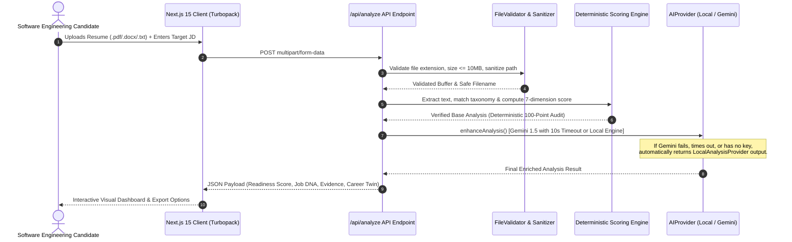

# 🚀 AI-Resume-Analyzer — Intelligent Career & Recruitment Analytics

[](https://github.com/2005swathi2000/AI-Resume-Analyzer/actions/workflows/ci.yml)
[](https://ai-resume-analyzer-sand-beta.vercel.app/)
[](https://www.typescriptlang.org/)
[](https://nextjs.org/)
[](https://vitest.dev/)
[](LICENSE)

> **"Know your match. See your gaps. Build your path."**  
> An explainable, evidence-backed career intelligence and ATS analysis platform designed for modern software engineering placements. Transforms any job description and candidate resume into a transparent, mathematically grounded 100-point compatibility audit with zero black-box obscurity.

🌐 **Production Deployment:** [https://ai-resume-analyzer-sand-beta.vercel.app/](https://ai-resume-analyzer-sand-beta.vercel.app/)

---

## 📑 Table of Contents
1. [Architectural Overview](#-architectural-overview)
2. [Data Flow & System Architecture](#-data-flow--system-architecture)
3. [Signature Platform Features](#-signature-platform-features)
4. [Transparent 100-Point ATS Scoring Formula](#-transparent-100-point-ats-scoring-formula)
5. [Privacy, Data Governance & Security](#-privacy-data-governance--security)
6. [Tech Stack](#-tech-stack)
7. [Local Setup Guide (Windows 11 / macOS / Linux)](#-local-setup-guide)
8. [Automated Test Suite (37 Verified Tests)](#-automated-test-suite)
9. [Multi-Platform Messaging Bot Integration](#-multi-platform-messaging-bot-integration)
10. [2027 SDE Placement Interview Q&A](#-2027-sde-placement-interview-qa)

---

## 🏛️ Architectural Overview

Unlike typical "wrapper" applications that send raw resumes directly to proprietary LLMs, **AI-Resume-Analyzer** uses a **hybrid deterministic core** paired with an **optional enhancement layer**:

```
┌────────────────────────────────────────────────────────────────────────┐
│                        USER RESUME & TARGET JD                         │
└───────────────────────────────────┬────────────────────────────────────┘
                                    │
                         [File Validator & Sanitizer]
                         • 10MB Buffer Limit
                         • Path Traversal & Null Byte Stripping
                         • Format Whitelist (.pdf, .docx, .txt)
                                    │
                                    ▼
       ┌─────────────────────────────────────────────────────────┐
       │             DETERMINISTIC PROCESSING CORE               │
       │  • Text Extraction (pdf-parse / mammoth)                │
       │  • Skill Taxonomy Normalization (400+ Canonical Skills) │
       │  • Multi-Tier Keyword & Responsibility Matcher          │
       │  • 100-Point ATS Mathematical Scorer                    │
       │  • Interactive Radial SVG "Job DNA Map" Engine          │
       │  • 10-Second Recruiter Lens & Signal Audit              │
       │  • What-If Career Simulation Engine                     │
       └────────────────────────────┬────────────────────────────┘
                                    │
                                    ▼
       ┌─────────────────────────────────────────────────────────┐
       │             ADAPTIVE INTELLIGENCE LAYER                 │
       │                                                         │
       │  [Default / Offline]         [Cloud Enhanced (Opt-In)]  │
       │  LocalAnalysisProvider       GeminiProvider             │
       │  • 100% Deterministic        • Google Gemini 1.5 Flash  │
       │  • Zero Data Leaves Machine  • 10s Timeout Protection   │
       │  • Zero Rate Limits / Free   • Auto-Fallback to Local   │
       └────────────────────────────┬────────────────────────────┘
                                    │
                                    ▼
┌────────────────────────────────────────────────────────────────────────┐
│                     RICH REACT 19 UI DASHBOARD                         │
│  Job Readiness Meter • Traceable Evidence • Career Twin • Mock Prep    │
└────────────────────────────────────────────────────────────────────────┘
```

---

## 📊 Data Flow & System Architecture



---

## 🌟 Signature Platform Features

| Feature | Description | Engineering Highlights |
| :--- | :--- | :--- |
| **🎯 Job Readiness Hero Score (0–100%)** | Comprehensive readiness index across 7 dimensions with clear tier rankings. | Deterministic scoring with zero black-box variance. |
| **🧬 Interactive SVG "Job DNA Map"** | Radial constellation visualization centered on target role. | Pure dynamic SVG with physics-like distribution across 8 clusters. |
| **👥 Career Twin Alignment Map** | Side-by-side node comparison linking target role expectations to candidate profile. | Visual evidence markers: Verified, Semantic, Partial, Not Detected. |
| **🔗 Traceable Evidence Explorer** | Links every single score point directly to exact resume text quotes. | Full explainability; no invented credentials or opaque metrics. |
| **❓ Why Isn't Your Score Higher?** | Drawer breaking down the exact points lost per category and how to recover them. | Categorized into Critical, High, and Medium deductions. |
| **🔮 WHAT-IF Career Simulator** | Checkbox simulator showing projected score improvement upon adding missing skills. | Purely deterministic projection with explicit estimation disclaimer. |
| **⏱️ 10-Second Recruiter Lens** | Simulates how a technical recruiter scans your resume in the first 10 seconds. | Identifies "Above the Fold" signals vs buried accomplishments. |
| **🎤 Strict AI Mock Interviewer** | Real-time mock technical, behavioral, and project interview with rubric evaluations. | Relevance gating (<20% triggers off-topic warning), keyword-stuffing detection. |
| **🤖 Multi-Platform Career Copilot** | Connects Telegram, Discord, Google Chat, and WhatsApp via webhooks. | Session-backed conversational copilot operable on phone or chat client. |
| **📑 Multi-Format Export** | Instant export as PDF, GitHub-ready Markdown, or raw JSON. | Client-side printing styles and clean semantic markdown formatting. |

---

## 📐 Transparent 100-Point ATS Scoring Formula

> **Important Disclosure:** An ATS score generated by this application is an **evidence-based estimate** of keyword and structural alignment. It does **not** guarantee an interview or employment outcome. Real-world ATS systems (e.g., Workday, Greenhouse, Taleo) use varying proprietary parsing engines.

The platform scores compatibility across **7 transparent dimensions** totaling **100 maximum points**:

$$\text{Total Score} = S_{\text{skills}} + S_{\text{keywords}} + S_{\text{experience}} + S_{\text{education}} + S_{\text{responsibilities}} + S_{\text{structure}} + S_{\text{parsing}}$$

| Dimension | Max Points | Evaluation Logic |
| :--- | :---: | :--- |
| **1. Skills Match** | **30** | Ratio of matched canonical JD skills against candidate resume text. |
| **2. Keyword Match** | **15** | Density and coverage of domain terms, tools, and methodologies. |
| **3. Experience / Project Alignment** | **15** | Technical complexity, backend/frontend involvement, database and API usage. |
| **4. Education Alignment** | **10** | Degree relevance (e.g., B.Tech / B.S. in CS/IT) or equivalent coursework. |
| **5. Responsibilities Alignment** | **10** | Action verbs matching JD duties (architected, implemented, optimized). |
| **6. Resume Structure** | **10** | Standard section headers (Experience, Projects, Skills, Education). |
| **7. ATS Parsing Compatibility** | **10** | Text extractability, font cleanliness, отсутствие unparseable tables or graphics. |
| **TOTAL** | **100** | **Mathematically verified: sum of awarded points $\le 100$.** |

---

## 🔒 Privacy, Data Governance & Security

1. **Zero Persistent Document Storage:** Uploaded resumes and job descriptions are parsed and scored strictly **in-memory** for the duration of the request session. No resumes, candidate names, or contact information are stored in a database or written to disk.
2. **Clear Operational Mode Distinction:**
   - **Deterministic Local Engine Mode (Default / Offline):** When no API key is configured, 100% of the extraction, taxonomy normalization, ATS scoring, and interview prep runs locally on your machine. Zero bytes leave your server.
   - **Gemini-Enhanced Mode (Opt-In):** When `GEMINI_API_KEY` or `GOOGLE_API_KEY` is provided, relevant extracted skills and role titles are sent over HTTPS to Google's Gemini 1.5 Flash API for conversational coaching and project bullet rewrites.
3. **Network Transmission & Fallback Disclosure:** If a Gemini API call is attempted and subsequently times out or encounters an API error (e.g. rate limit, 500 error), **data was already transmitted to Google** before the failure. The system's graceful fallback to `LocalAnalysisProvider` guarantees zero user-facing downtime, but users who require strict data privacy must operate in Local Engine Mode with no Gemini API key configured.
4. **Active Timeout & Connection Abort:** The `GeminiProvider` employs an `AbortController` linked to `@google/generative-ai`'s request options. If an API request exceeds **10 seconds**, the underlying HTTP connection is actively aborted at the socket level, preventing serverless function hangs and unnecessary resource consumption.
5. **Strict Input Sanitization & Safety Caps:**
   - File extensions are validated against an allowlist (`.pdf`, `.docx`, `.txt`).
   - Filenames are sanitized against directory traversal (`../`, `..\`) and null byte injections (`\0`).
   - File buffers are capped at **10 MB** to prevent buffer overflow and memory exhaustion.
   - Extracted text is capped at **150,000 characters** to protect against ReDoS attacks.

---

## 🛠️ Tech Stack

- **Framework:** [Next.js](https://nextjs.org/) (`16.3.4`, App Router with Turbopack)
- **Library:** [React 19](https://react.dev/) (`19.2.8`)
- **Language:** [TypeScript 5](https://www.typescriptlang.org/) (Strict Mode)
- **Styling:** Modern Vanilla CSS Design System with dark/light theme tokens and responsive layouts
- **Parsing:** `pdf-parse` (PDF text extraction), `mammoth` (DOCX extraction)
- **AI Enhancement:** `@google/generative-ai` (Gemini 1.5 Flash) with fallback to deterministic local engine
- **Testing:** [Vitest 3.2.7](https://vitest.dev/)
- **Icons:** [Lucide React](https://lucide.dev/)
- **Deployment:** [Vercel](https://vercel.com/)

---

## 💻 Local Setup Guide

### Prerequisites
- Node.js **18.x** or **20.x** (Tested on Node.js v22.19.0 on Windows 11)
- Git installed

### 1. Clone the Repository
```bash
git clone https://github.com/2005swathi2000/AI-Resume-Analyzer.git
cd AI-Resume-Analyzer
```

### 2. Install Dependencies
```bash
npm install
```

### 3. Environment Configuration (Optional)
Copy the example environment configuration:
```bash
# Windows PowerShell:
Copy-Item .env.example .env.local

# macOS / Linux:
cp .env.example .env.local
```

*(Optional)* Add your Gemini API key in `.env.local`:
```env
GEMINI_API_KEY=your_gemini_api_key_here
```
> **Note:** If omitted, the application runs perfectly using the built-in deterministic **Local Analysis Engine** with zero external dependencies.

### 4. Run the Automated Test Suite
```bash
npm test
```

### 5. Start the Development Server
```bash
npm run dev
```
Open [http://localhost:3000](http://localhost:3000) in your browser.

---

## 🧪 Automated Test Suite

The repository contains **40 comprehensive unit, integration, and security tests** running via Vitest:

```bash
$ npm test

 RUN  v3.2.7
 ✓ tests/interview.test.ts (5 tests)
 ✓ tests/pipeline.test.ts (14 tests)
 ✓ tests/security-validation.test.ts (21 tests)

 Test Files  3 passed (3)
      Tests  40 passed (40)
   Duration  2.56s
```

### Test Coverage Highlights
1. **Security & File Validation (`tests/security-validation.test.ts`)**:
   - Path traversal and null byte stripping
   - File extension whitelisting (.pdf, .docx, .txt)
   - 10 MB file size limit enforcement
   - Zero-byte file rejection
   - 150,000 character buffer cap
   - Gemini API timeout and graceful fallback
   - Mathematical verification of the 100-point scoring breakdown
2. **Analysis Pipeline (`tests/pipeline.test.ts`)**:
   - Text cleaning and Unicode normalization
   - Skill taxonomy canonicalization
   - Job description parsing and requirement clustering
   - Multi-resume batch sorting and comparative ranking
   - Traceable evidence link validation
3. **Interview Engine (`tests/interview.test.ts`)**:
   - Strict rubric evaluation
   - Irrelevant answer detection (<20% score)
   - Keyword-stuffing penalty verification
   - Follow-up question generation

---

## 🤖 Multi-Platform Messaging Bot Integration

The application features a unified webhook gateway located at `/api/webhooks/[platform]` supporting:

| Platform | Webhook Endpoint | Setup Parameter |
| :--- | :--- | :--- |
| **Telegram** | `/api/webhooks/telegram` | `TELEGRAM_BOT_TOKEN` |
| **Discord** | `/api/webhooks/discord` | `DISCORD_BOT_TOKEN` |
| **Google Chat** | `/api/webhooks/google-chat` | `GOOGLE_CHAT_WEBHOOK_URL` |
| **WhatsApp** | `/api/webhooks/whatsapp` | `WHATSAPP_ACCESS_TOKEN`, `WHATSAPP_PHONE_NUMBER_ID` |

---

## 🎯 2027 SDE Placement Interview Q&A

### Q1: Why did you build a hybrid deterministic engine instead of using a prompt-only LLM wrapper?
> **Answer:** "A pure LLM approach introduces non-deterministic hallucinations, latency spikes, rate limits, and significant token costs. In technical recruiting and ATS scoring, explainability is paramount. By building a deterministic 100-point scoring algorithm across 7 dimensions (skills, keywords, experience, education, responsibilities, structure, parsing), we guarantee identical scores for identical inputs. We use Google Gemini solely as an optional enhancement layer for conversational coaching and creative bullet rewrites, with guaranteed offline fallback."

### Q2: How does the application prevent ReDoS and memory exhaustion attacks from malicious resume uploads?
> **Answer:** "In `src/lib/parser/file-validator.ts`, we implement defense-in-depth:
> 1. Buffer size is capped at 10 MB (`MAX_FILE_SIZE_BYTES`), rejecting oversized files before parsing.
> 2. File extensions are whitelisted to `.pdf`, `.docx`, and `.txt`.
> 3. Uploaded filenames are sanitized against path traversal (`../`) and null byte injections (`\0`).
> 4. Extracted text is capped at 150,000 characters (`MAX_RAW_TEXT_LENGTH`), preventing regex backtracking bottlenecks on deeply nested documents."

### Q3: How do you handle Gemini API rate limits and network timeouts?
> **Answer:** "In `src/lib/ai/gemini-provider.ts`, every network call to `@google/generative-ai` is wrapped inside a 10-second `withTimeout()` promise race. If the API key is missing, invalid, rate-limited, or exceeds 10 seconds, the error is caught safely and the request seamlessly delegates to `LocalAnalysisProvider`. The user receives complete, high-quality analysis without seeing an unhandled error or infinite spinner."

### Q4: How is the SVG Job DNA Map generated?
> **Answer:** "In `src/components/JobDnaMap.tsx`, the requirements extracted from the JD are categorized into 8 functional clusters (Tech Stack, Experience, Responsibilities, Education, Tools, Soft Skills, Domain, Certifications). We use trigonometry (`cos`, `sin`) to arrange the clusters radially around the target role center node, drawing connecting SVG lines and coloring nodes green, yellow, or red based on evidence found in the resume."

### Q5: What is your data retention and privacy policy for uploaded resumes?
> **Answer:** "Uploaded resumes and job descriptions are processed strictly in-memory per HTTP request session. No candidate data, names, emails, or resume texts are written to disk or persisted in a database. If the user does not provide an external LLM key, zero bytes ever leave the local deployment."

---

## 📄 License
This project is open-source under the [MIT License](LICENSE).
